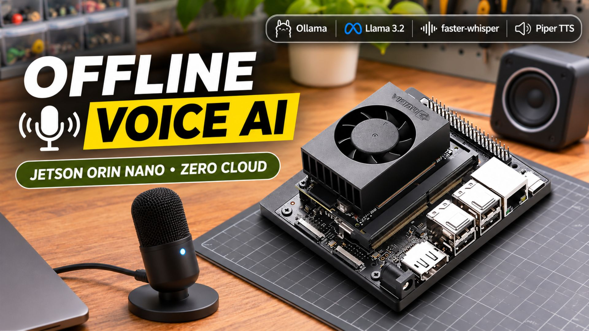

# Offline Voice Assistant on NVIDIA Jetson Orin Nano

A fully local, low-latency, and privacy-preserving voice assistant running entirely on-device without cloud services or internet access. Designed specifically for embedded edge AI systems such as the NVIDIA Jetson Orin Nano, this **project delivers an interactive conversational voice loop** featuring wake-word activation, multi-turn follow-up dialogue, local Large Language Model (LLM) reasoning, and neural text-to-speech synthesis.  
  
  

## Project Overview

Running conversational AI on edge hardware typically encounters three hurdles: memory limitations, thermal throttling, and hardware-specific compilation conflicts (such as cuDNN/CTranslate2 mismatches). 

This project solves those challenges on the **NVIDIA Jetson Orin Nano (8GB)** by orchestrating a balanced compute workload:
* **LLM Engine:** GPU-accelerated quantized local inference (`llama3.2:3b` via Ollama) with active memory pooling.
* **Speech-to-Text (STT):** Fast CPU-side quantized transcription (`faster-whisper` on INT8) to conserve GPU VRAM and maintain stability.
* **Text-to-Speech (TTS):** Low-overhead, real-time neural voice generation using Piper TTS.
* **Audio Layer:** Direct ALSA subsystem integration with universal hardware auto-detection.

## Key Features

* **100% Offline & Private:** Zero telemetry, no external network requests, and no third-party cloud API keys required.
* **State-Machine Conversational Loop:**
  * *Passive Standby:* Continuously samples ambient noise in short intervals without running heavy inference.
  * *Wake Trigger:* Responds to `"Hey Joy"` (and related phonetic variants).
  * *Follow-Up Window:* Maintains an active conversational session for subsequent questions without requiring the wake word every time.
  * *Auto-Sleep:* Automatically returns to passive listening after 3 consecutive silent turns.
* **Universal Hardware Audio Resolver:** Scans ALSA interfaces at startup to automatically discover USB microphones, headsets, and webcams, eliminating hardcoded hardware indices.
* **Optimized Thermal/Power Envelope:** Operates reliably under the Jetson 25W power profile, hovering around ~50°C under active load.

## Hardware Requirements

| Component | Specification |
| :--- | :--- |
| **SBC** | NVIDIA Jetson Orin Nano Developer Kit (8GB) |
| **Storage** | 128GB+ NVMe PCIe M.2 SSD (high speed recommended) |
| **Power Supply** | Standard Jetson 19V DC power supply |
| **Microphone** | Standard USB Microphone, USB Headset, or USB Webcam (e.g., Logitech C270) |
| **Speaker** | 3.5mm AUX Speaker, USB Audio Output, or Monitor Audio via DisplayPort/HDMI |
| **Cooling** | Active PWM cooling fan |

## Software Requirements

* **Operating System:** Ubuntu 22.04 LTS (JetPack 6.x)
* **Python Runtime:** Python 3.10+ with `venv`
* **Audio Drivers:** `alsa-utils`, `sox`, `libsox-fmt-all`
* **Model Engines:** 
  * Ollama (`llama3.2:3b`)
  * `faster-whisper`
  * Piper TTS (`en_US-lessac-medium`)

## Tutorial Guides & Videos

* **Official NVIDIA Getting Started Guide:** [NVIDIA Jetson Orin Nano DevKit Documentation](https://developer.nvidia.com/embedded/learn/get-started-jetson-orin-nano-devkit)
* **Jetson Orin Nano Setup & Unboxing:** `[INSERT_YOUTUBE_VIDEO_LINK_HERE]`
* **Complete Step-by-Step Project Walkthrough:** `[INSERT_VOICE_ASSISTANT_VIDEO_LINK_HERE]`

------------------------------------------------------------------------------------------------------

📕 **YouTube Video Links**  

▶️ Jetson Orin Nano Super Developer Kit : Unboxing & Specs 🔗  https://youtu.be/QPcrAhREJjQ  

▶️ Jetson Orin Nano Super Developer Kit Setup Guide (2026) 🔗  https://youtu.be/KXQEhidMDfc  

▶️ Zero Cloud, Full Conversation: Offline AI Voice Assistant on Jetson Orin Nano  🔗  https://youtu.be/  
  

-------------------------------------------------------------------------------------------------------
📒 **Important Links**  
 
📖 Jetson Orin Nano Super Quick Start Guide :🔗 https://docs.nvidia.com/jetson/orin-nano-devkit/user-guide/latest/quick_start.html  
  
💾 Jetson Developer Zone : 🔗 https://developer.nvidia.com/embedded-computing  
  
📞 Jetson Support Forums : 🔗 https://forums.developer.nvidia.com/c/robotics-edge-computing/jetson-systems/jetson-orin-nano/632  
  
🚨 NVIDIA Jetson Zoo Catalog : 🔗 https://elinux.org/Jetson_Zoo  
  
📌 Jetson Community Projects  :  🔗 https://developer.nvidia.com/embedded/community/jetson-projects  
  

🛒  Purchase  -   
NVIDIA Official Website : 🔗 https://developer.nvidia.com/embedded/buy-jetson  

Product page :  🔗 https://www.nvidia.com/en-us/autonomous-machines/embedded-systems/jetson-orin/nano-super-developer-kit/  

------------------------------------------------------------------------------------------------------

📜 Source Code, Circuit Diagrams and Documentation : 

🌐 GitHub Repository - 🔗 https://github.com/make2explore/  
  
🌐 Hackster Blog - 🔗 https://www.hackster.io/make2explore  
  
🌐 Instructable Blog - 🔗 https://www.instructables.com/make2explore  

---

## License

This project is released under the [MIT License](LICENSE).